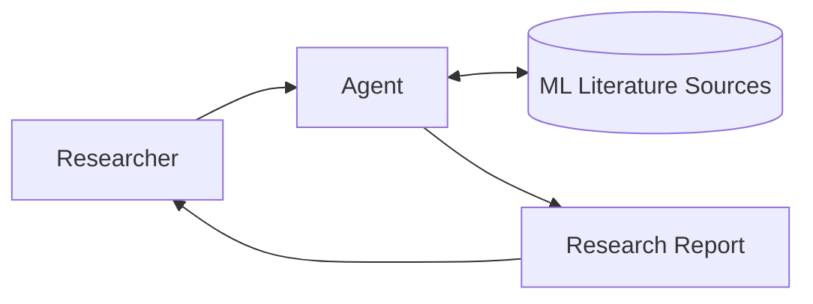
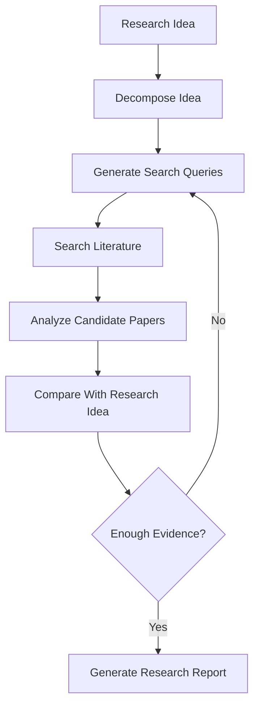

# Agent Definition
This project is an AI agent specialized in **machine learning research** that investigates whether a proposed research idea has already been explored in the existing literature. It searches and analyzes relevant ML papers to identify closely related work, similarities, differences, and potential research gaps.

# Agent Architecture

